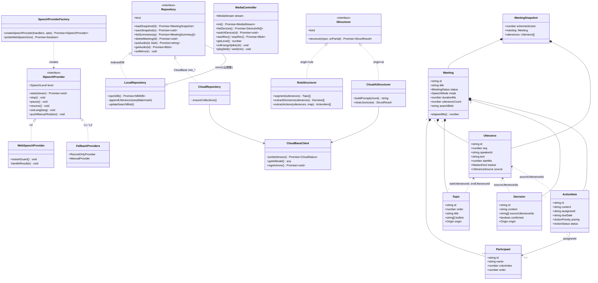
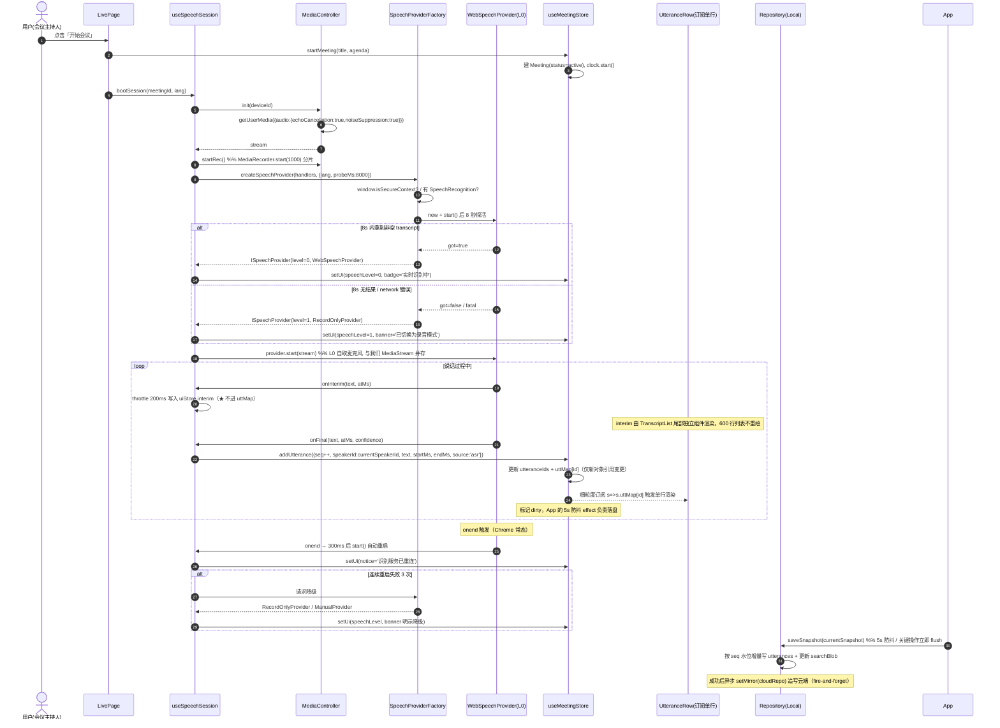
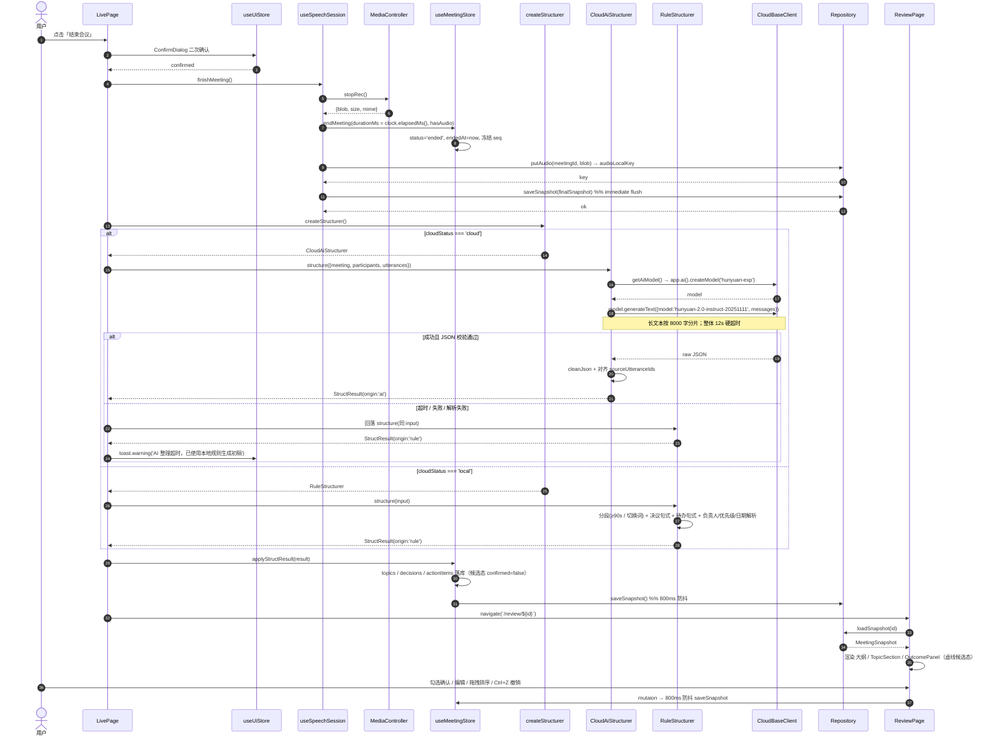
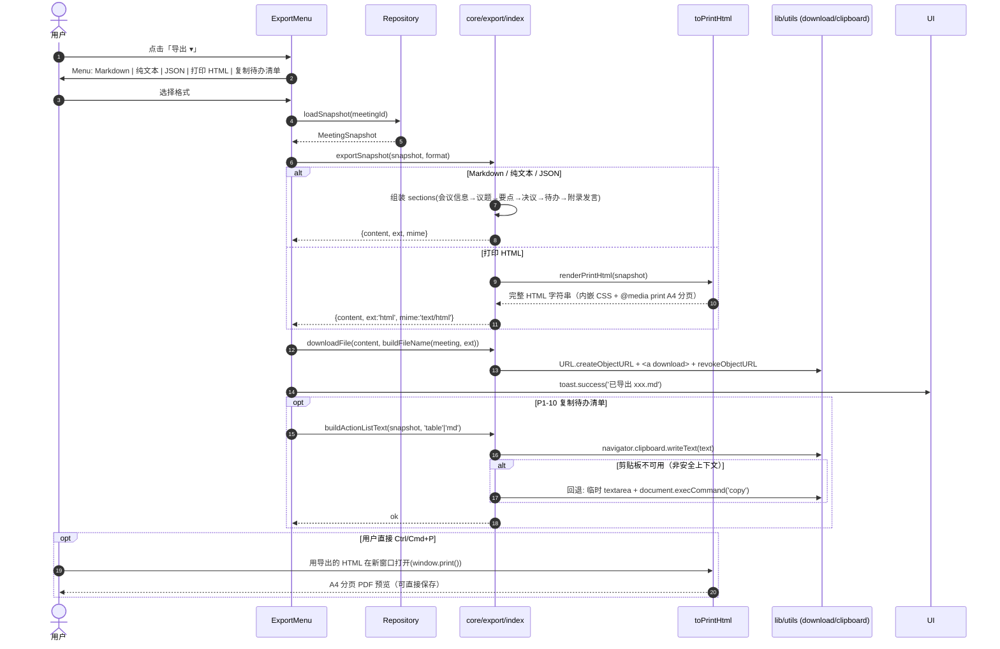
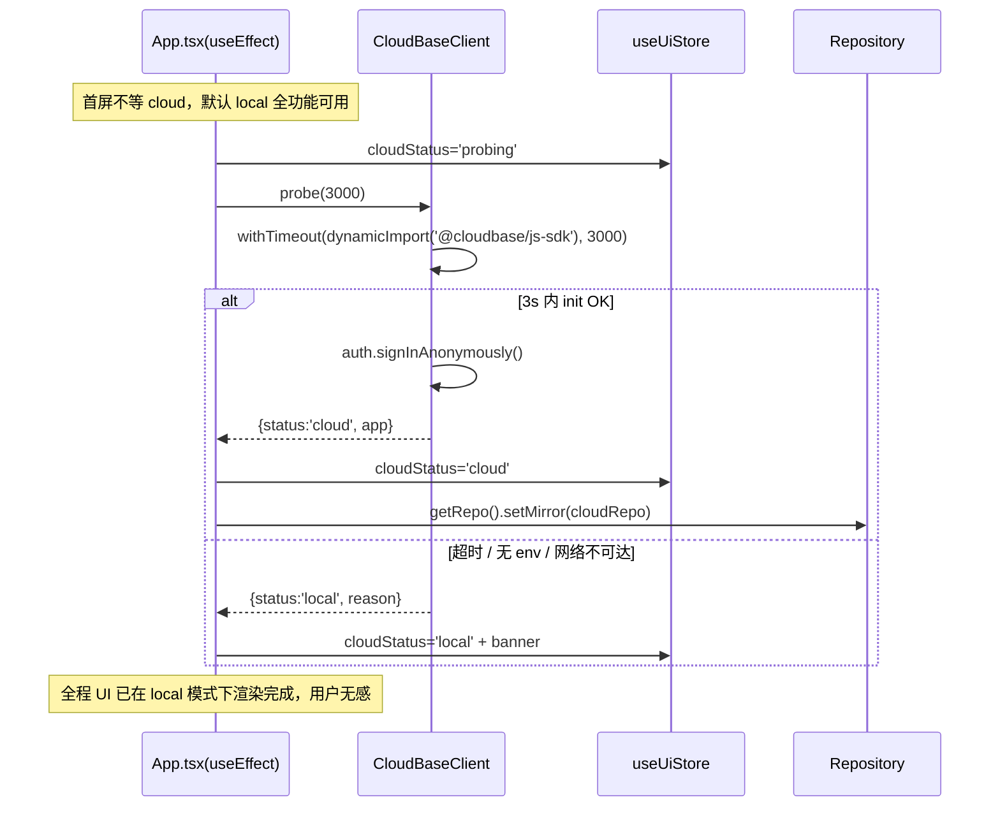
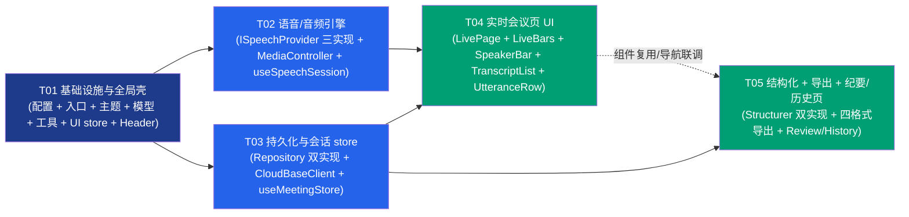

# MeetingMind 系统架构设计文档

| 项目信息 | 内容 |
|---|---|
| 产品名称 | MeetingMind（会议纪要智能助手） |
| 架构版本 | v1.0 |
| 架构师 | 高见远（Gao） |
| 上游输入 | `docs/PRD.md`（v1.0，许清楚） |
| 交付形态 | Web 应用（Chrome / Edge 110+，桌面优先） |
| 项目根目录 | `D:/work Buddy/2026-10-31-01-41-26/meetingmind` |
| 运行环境 | Windows + Node v22.22.2 + npm 10.9.7（已实测） |
| 本轮实现范围 | **全部 P0（P0-01 ~ P0-19）** + P1-05 能量启发式提示 + P1-07 实时打点 + P1-10 待办清单导出 |
| 源文件规模 | **src 下 36 个代码文件** + 根目录 7 个配置文件 + 1 个 `.env.example` |

---

## 1. 实现方案与框架选型

### 1.1 核心技术挑战与对策

| # | 挑战 | 对策 |
|---|---|---|
| C1 | Web Speech API 无 TS 类型、且依赖厂商在线服务不可靠 | 自写 `types/global.d.ts`（**不使用** `@types/dom-speech-recognition`，避免与新版 `lib.dom.d.ts` 重复声明冲突）；启动 **8 秒探活** + 三级降级 L0/L1/L2；`onend` 300ms 自动重启，连续失败 3 次降级 |
| C2 | CloudBase 初始化可能超时/失败，**不能阻塞首屏** | 首屏一律以「本地模式」渲染；云端探测在 `useEffect` 中异步进行，`Promise.race` 加 **3s 超时**；成功后热切换（不影响已渲染内容） |
| C3 | interim 每 200ms 刷新 + 1 小时 600+ 条发言，**必须不卡** | ① interim **不进列表**，独立组件渲染；② 行级细粒度 Zustand 订阅（`s => s.uttMap[id]`）；③ `@tanstack/react-virtual` 窗口化；④ IndexedDB 只写增量（按 `seq` 水位哨兵） |
| C4 | Tailwind preflight 与 MUI CssBaseline 两套全局样式互相打架（h1/字号/盒子模型被重置两次） | **关闭 Tailwind preflight** + MUI `CssBaseline` 负责归一化 + `StyledEngineProvider injectFirst` 保证 Tailwind 原子类压过 MUI（详见 §1.3） |
| C5 | 有云/无云双路径必须保持数据结构一致 | 单一 TS 模型 + `Repository` / `IStructurer` 双接口双实现，仅 `origin` 字段区分 `ai`/`rule`；UI 与导出零分叉 |
| C6 | 暂停/继续/切换设备不能中断已录音频 | MediaRecorder 绑定**同一个 MediaStream 对象**；切换设备只做 `removeTrack/addTrack` 换轨，不重建流；时钟用「累计活动时长」而非 `Date.now()` 差值 |
| C7 | 刷新/崩溃丢数据 | IndexedDB 每 5s 防抖落盘 + 关键操作 immediate flush；启动时恢复 `status !== 'ended'` 的会议 |

### 1.2 框架选型表

| 层 | 选型 | 版本 | 一句话理由 |
|---|---|---|---|
| 构建 | Vite | `^5.4.21` | Vite 5 在 Node 22 + Windows 上 rollup 原生二进制最稳；Vite 6/7 对 Node 小版本有更严约束，不冒险 |
| 语言 | TypeScript | `~5.5.4` | 锁小版本：避免 5.6+ 的 `lib.dom.d.ts` 引入自带 SpeechRecognition 类型导致重复声明 |
| UI 运行时 | React | `^18.3.1` | **不用 19**：MUI v5 未官方支持 React 19，类型与新并发行为有风险 |
| 组件库 | `@mui/material` + `@mui/icons-material` | `^5.18.0` | 锁 v5：**不用 v6/v7**，避开 Grid 组件 API 破坏性变更（v6 Grid→Grid2、v7 又改）；且 v5 对 React 18 支持最成熟 |
| 样式引擎 | `@emotion/react` + `@emotion/styled` | `^11.11.4` | MUI v5 的必需 peer，`injectFirst` 依赖 emotion 顺序控制 |
| 原子样式 | Tailwind CSS | `^3.4.19` | **不用 v4**：v4 改为 CSS-first `@theme` 配置 + `@tailwindcss/postcss` 插件，与 Vite 5 组合坑较多；v3 的 `corePlugins.preflight` 开关是本次去重关键开关 |
| 状态管理 | Zustand | `^4.5.7` | 高频会话场景；用内置 `subscribeWithSelector` + `persist` 中间件做细粒度订阅与偏好持久化，避免引入 Redux / immer |
| 路由 | react-router-dom | `^6.30.6` | 用 **HashRouter**：CloudBase 静态托管默认无 SPA fallback，hash 路由零配置可用 |
| 虚拟滚动 | `@tanstack/react-virtual` | `^3.14.24` | 无侵入、支持动态行高测量（发言文本换行高度不定），比自研窗口化稳 |
| 本地存储 | `idb` | `^8.0.4` | IndexedDB 的 Promise 封装，避免手写 60+ 行样板；纯浏览器包，Node 22 安装无原生依赖 |
| 云端 SDK | `@cloudbase/js-sdk` | `^2.28.8` | **v2 线**（已核实 dist 内含 `ai` 子模块、`index.d.ts` 含 `app.ai(): AI`、`init` 支持 `accessKey`、auth 支持 `signInAnonymously`）；v3/v4 为 beta 线，不采用 |
| 日期处理 | 原生 `Intl` + 自写 pad | — | 只需 `HH:mm:ss` 与 `YYYY-MM-DD`，不引 dayjs / date-fns，少一个依赖少一份风险 |
| ID 生成 | `crypto.randomUUID` + 自写回退 | — | 安全上下文必有；非 HTTPS 时回退为时间戳+随机串，避免引入 uuid/nanoid |

### 1.3 Tailwind preflight 与 MUI 冲突的处理决策

**决策（三条同时执行，缺一不可）：**

1. **关闭 Tailwind preflight**：Tailwind 不再输出全局重置样式（`*,::before{box-sizing:border-box}`、`h1{margin:0;font-size:inherit}` 等），由 MUI 的 `<CssBaseline />` 统一负责归一化。
2. **`<StyledEngineProvider injectFirst>`**：让 emotion（MUI）的 `<style>` 标签注入到 `<head>` 最前，Tailwind 的 utility 类（后注入）在 CSS 同等特异性下胜出，保证 `className="flex gap-2 p-3"` 能覆盖 MUI 组件自带样式。
3. **职责边界写死**：「组件外观/交互」只用 MUI（`Button/Dialog/Select/Menu/Snackbar/Tooltip/IconButton`）；「布局与间距」只用 Tailwind（`flex/grid/gap/p-*/w-*/text-* 尺寸`）与 MUI 的 `sx`（仅用于需要读 theme 的地方）。禁止同一元素既用 `sx` 又用 Tailwind 写同一属性（如 `sx={{p:2}}` + `className="p-3"`）。

```js
// tailwind.config.js  —— package.json 已设 "type": "module"，故用 ESM 导出
export default {
  content: ['./index.html', './src/**/*.{ts,tsx}'],
  corePlugins: { preflight: false },   // ★ 关键：关掉 preflight，避免和 MUI CssBaseline 抢全局样式
  theme: { extend: { colors: { brand: { DEFAULT: '#2563EB', deep: '#1E3A8A' } } } },
  plugins: [],
};
```

```tsx
// src/main.tsx（关键片段）
import { StyledEngineProvider, ThemeProvider, CssBaseline } from '@mui/material';
createRoot(el).render(
  <StrictMode>
    <StyledEngineProvider injectFirst>   {/* ★ 让 MUI 样式先注入，Tailwind 原子类可覆盖 */}
      <ThemeProvider theme={theme}>
        <CssBaseline />                   {/* ★ 归一化由 MUI 负责 */}
        <HashRouter><App /></HashRouter>
      </ThemeProvider>
    </StyledEngineProvider>
  </StrictMode>
);
```

### 1.4 版本锁与已知坑（工程师必读）

| 坑 | 表现 | 规避写法 |
|---|---|---|
| K1 SpeechRecognition 无类型 / 重复声明 | `TS2339 Property 'SpeechRecognition' does not exist` 或 `Duplicate identifier` | **不用** `@types/dom-speech-recognition`；在 `src/types/global.d.ts` 里用**自定义前缀名**（`MMSpeechRecognition…`）声明，再 `const SR = (window as any).SpeechRecognition ?? (window as any).webkitSpeechRecognition as MMSpeechRecognitionCtor \| undefined`，彻底不和 lib.dom 撞名（见 §3.3.2） |
| K2 MUI v6/v7 Grid 破坏性变更 | 升级后 `@mui/material/Grid` 行为改变 | 锁 `@mui/material@^5.18.0`；且本项目**不使用 Grid 组件**，布局一律 Tailwind flex/grid |
| K3 Tailwind v4 配置迁移 | `@tailwind base` 失效、`tailwind.config.js` 不生效 | 锁 `tailwindcss@^3.4.19` + `postcss@^8.4` + `autoprefixer@^10.4`；`index.css` 用 `@tailwind base/components/utilities`（注意：base 部分在 preflight 关闭后只剩 CSS 变量，无副作用） |
| K4 `@cloudbase/js-sdk` 的 d.ts 依赖缺失类型 | TS 报 `Cannot find module '@cloudbase/ai'` | `tsconfig.json` 必须 `"skipLibCheck": true`（抑制三方 d.ts 内部错误）；AI 相关调用统一走 `core/cloud/CloudBaseClient.ts` 的**动态 import**，避免预构建失败阻塞整个 build；`vite.config.ts` 加 `optimizeDeps.exclude: ['@cloudbase/js-sdk']` |
| K5 非安全上下文 | `getUserMedia` / `SpeechRecognition` 为 `undefined` | 入口做 `window.isSecureContext` 判定，http 非 localhost 直接进 L2 并给出「需 HTTPS」文案（P0-02③） |
| K6 `__dirname` 在 ESM 配置中不存在 | `vite.config.ts` 里用 `__dirname` 报 ReferenceError | 用 `fileURLToPath(new URL('./src', import.meta.url))`，并安装 `@types/node` |
| K7 Windows + Node 22 的 shell 脚本 | `cross-env` 类依赖非必需 | 本项目 `scripts` 全部用裸命令（`vite`、`tsc`），不引 `cross-env` |
| K8 `SpeechRecognition` 8 秒探活时二次弹权限 | 体验受损 | 探活**放在 `getUserMedia` 之后**（同源已授权则不再弹窗）；Chrome Web Speech 内部自行开麦，与我们持有 MediaStream 并存，互不抢占（P0-09①） |
| K9 MediaRecorder 的 `ondataavailable` 不触发 | 录不到音频 | `start(1000)` 传 timeslice，每 1s 出一片 Blob 进数组，stop 时一次性合成；避免单一大 Blob 峰值内存 |

### 1.5 降级架构总览

| 场景 | ASR 级别 | 数据层 | 结构化引擎 | UI 徽标 |
|---|---|---|---|---|
| HTTPS/localhost + 支持 + 8s 探活成功 + 已配置 CloudBase | L0 | CloudBase（镜像本地） | CloudAiStructurer | 云端 + 实时识别 |
| 支持不佳但不完全失败（8s 无结果 / `network` 错误） | L1 仅录音 | IndexedDB | RuleStructurer | 录音模式 |
| 不支持 / 非安全上下文 / 麦克风被拒 | L2 手动记录 | IndexedDB | RuleStructurer | 本地模式（手动） |
| 无 CloudBase 环境（默认开箱场景） | L0/L1/L2 | IndexedDB | RuleStructurer | 本地模式 |

> **铁律**：任何一级降级下，议题分段 / 决议抽取 / 待办抽取 / 编辑 / 导出四格式 / 历史检索必须 **100% 可用**；降级必须在 UI 顶部 `ModeBanner` 明示，绝不静默失败。

---

## 2. 完整文件列表

> 约定：路径别名 `@/` → `src/`（在 `vite.config.ts` 与 `tsconfig.json` 同步配置）。

### 2.1 根目录配置（7 + 1）

| 路径 | 职责 | 预估行数 |
|---|---|---|
| `package.json` | 依赖声明、scripts（`dev` / `build` / `preview` / `typecheck`）、`"type": "module"` | 40 |
| `tsconfig.json` | 应用编译配置：`strict`、`skipLibCheck`、`paths.@/*`、`lib: [ES2020, DOM, DOM.Iterable]` | 35 |
| `tsconfig.node.json` | 仅给 `vite.config.ts` 用（`@types/node`） | 12 |
| `vite.config.ts` | React 插件、`@` 别名、`server.host`、build target、`optimizeDeps.exclude` | 25 |
| `tailwind.config.js` | content 范围、**关闭 preflight**、brand 色扩展 | 15 |
| `postcss.config.js` | tailwindcss + autoprefixer | 8 |
| `index.html` | 挂载点、`<html lang="zh-CN">`、中文字体栈、favicon | 20 |
| `.env.example` | `VITE_CLOUDBASE_ENV` / `VITE_CLOUDBASE_REGION` / `VITE_ENABLE_CLOUD` 说明 | 10 |

### 2.2 `src/` 根与基础设施（6 个）

| 路径 | 职责 | 预估行数 |
|---|---|---|
| `src/main.tsx` | React 入口：`StyledEngineProvider injectFirst` + ThemeProvider + CssBaseline + HashRouter；挂载前注册全局错误处理 | 30 |
| `src/App.tsx` | 路由（`/` 历史页、`/live/:id` 实时页、`/review/:id` 纪要页）；启动 bootstrap（云端探测、恢复未结束会议）；**全局快捷键注册**；**5s 自动落盘 effect**；全局 Snackbar 宿主 | 180 |
| `src/theme.ts` | MUI 主题（主色 `#1E3A8A`、强调 `#2563EB`、中文字体栈、圆角/间距）；导出 `SPEAKER_COLORS`（Okabe-Ito 8 色）与 `speakerColor(idx)` | 70 |
| `src/index.css` | `@tailwind` 三条指令 + 少量全局类（`.scroll-thin`、`.utterance-interim` 斜体灰字）、打印基础 | 60 |
| `src/types/global.d.ts` | `/// <reference types="vite/client" />` + SpeechRecognition 全套自定义前缀类型与 `Window` 扩展 | 70 |
| `src/types/models.ts` | **单一事实来源**：Meeting / Participant / Utterance / Topic / Decision / ActionItem / MeetingSnapshot / MeetingSummary / 枚举 / SCHEMA_VERSION | 150 |

### 2.3 工具库（1 个）

| 路径 | 职责 | 预估行数 |
|---|---|---|
| `src/lib/utils.ts` | `newId()`、`mmss(ms)`、`hhmmss(ms)`、`fmtDateTime(ms)`、`fmtDurCN()`、`relDueDateCN()`、`escapeHtml()`、`escapeMd()`、`highlightSnippet()`、`debounce()`、`throttle()`、`withTimeout()`、`safeFileName()`、`sanitizeScan()`（见 §7） | 170 |

### 2.4 核心引擎 `src/core/`（12 个）

| 路径 | 职责 | 预估行数 |
|---|---|---|
| `src/core/speech/index.ts` | `ISpeechProvider` 接口 + `SpeechEventHandlers` + `SpeechLevel` + **`createSpeechProvider()` 工厂**（含 8s 探活降级判定） | 120 |
| `src/core/speech/WebSpeechProvider.ts` | L0：`continuous + interimResults`；`onresult` 区分 interim/final（按 `resultIndex` 遍历，避免重复）；`onend` 300ms 自动重启 + 连续失败计数；语言切换 | 200 |
| `src/core/speech/FallbackProviders.ts` | 同文件两个类：`RecordOnlyProvider`（L1，只走录音，产出空 interim + 「（录音中）」占位提示）与 `ManualProvider`（L2，暴露 `pushManualText` 给大文本框/粘贴外部转录） | 130 |
| `src/core/audio/MediaController.ts` | 单例：`getUserMedia`、设备枚举/换轨（不重建 MediaStream）、`MediaRecorder` 分片录制、`AnalyserNode` 音量采样、**能量突变检测**（P1-05）、录音 Blob 合成、`<audio>` 播放与 `seek(ms)` | 260 |
| `src/core/repo/index.ts` | `Repository` 接口、`MeetingQuery`、`getRepo()` 单例获取、`setMirror()` 镜像钩子、通用 `MMError` 与错误→中文文案映射 | 110 |
| `src/core/repo/LocalRepository.ts` | IndexedDB 实现：库打开/升级（含全部 objectStore 与索引）、按 `seq` 水位做增量写 utterances、`searchBlob` 维护、音频 Blob 存取、镜像异步追写 | 260 |
| `src/core/repo/CloudRepository.ts` | CloudBase 文档数据库实现：`mm_*` 集合 upsert / 批量 append、按 `_id` 去重、`whenCloudReady` 守卫、失败降级为本地并只提示一次 | 200 |
| `src/core/cloud/CloudBaseClient.ts` | 动态 `@cloudbase/js-sdk` 导入、`init`（3s 超时）、匿名登录、`app.ai()` 句柄缓存、`cloudStatus` 状态机、手动重试/切换 | 140 |
| `src/core/struct/index.ts` | `IStructurer` 接口 + `StructInput/StructResult` + `createStructurer()` 工厂（有云→AI，超时/失败→规则兜底） | 90 |
| `src/core/struct/RuleStructurer.ts` | 本地规则引擎：时间+关键词自动分段（候选）、决议句式抽取、待办句式抽取（负责人/优先级/日期解析）、要点摘要生成 | 280 |
| `src/core/struct/CloudAiStructurer.ts` | CloudBase AI `hunyuan-exp` 调用：Prompt 组装、8000 字分片、JSON 校验清洗、`origin:'ai'` 回填、`sourceUtteranceIds` 对齐 | 190 |
| `src/core/export/index.ts` | 导出编排：构建 `MeetingSnapshot`、文件名生成、Markdown / 纯文本 / JSON 序列化、Blob 下载、UE（P1-10）待办清单文本 + 剪贴板 | 220 |

### 2.5 导出分工（续 `src/core/`）

| 路径 | 职责 | 预估行数 |
|---|---|---|
| `src/core/export/toPrintHtml.ts` | 打印友好 HTML：内嵌 CSS、A4 分页、`@media print` 隐藏交互元素、决议/待办表格、完整发言附录 | 150 |

### 2.6 状态与 Hook（3 个）

| 路径 | 职责 | 预估行数 |
|---|---|---|
| `src/stores/useMeetingStore.ts` | 会话主 store：`utteranceIds` + `uttMap`（细粒度订阅）、`participants/topics/decisions/actionItems/markers`、`currentSpeakerId`、会议时钟（累计活动 ms）、**命令式撤销栈（≥20 步）**、批量归属校正、合并/拆分/删除 | 380 |
| `src/stores/useUiStore.ts` | 全局 UI：`cloudStatus`、`speechLevel`、`lang`、`deviceId`、`toast()`、`toastSel`、`clipboard-ready 提示`；`persist` 到 localStorage 的偏好（语言、默认设备、是否开启能量提示） | 120 |
| `src/hooks/useSpeechSession.ts` | 把 provider + MediaController + meetingStore 缝合：开始/暂停/继续/结束、 Speaker 归属写入、**interim 200ms 节流**到独立 store 字段、8s 探活结果驱动 ModeBanner、自动重启 | 230 |
| `src/hooks/useEnergyHint.ts` | P1-05：订阅 `MediaController.onEnergySpike`，非模态气泡提示「发言人可能已切换 → [姓名?]」，**绝不自动改写归属**，可全局关闭 | 90 |

### 2.7 组件与页面（14 个）

| 路径 | 职责 | 预估行数 |
|---|---|---|
| `src/components/AppHeader.tsx` | 顶栏：Logo、模式徽标（云端/录音/本地/手动）、`ModeBanner` 降级提示条、导航入口、**设置弹窗**（CloudBase 手动重试/切换、语言、识别开关、能量提示开关、清空数据） | 190 |
| `src/components/common/UiKit.tsx` | 三个小组件同文件：`ConfirmDialog`（二次确认，用于结束会议/删除）、`EmptyState`（插画+说明+CTA）、`SpeakerAvatar`（按 `colorIndex` 取色的圆形头像/字母） | 140 |
| `src/components/common/ExportMenu.tsx` | 导出下拉菜单 + 触发四种格式 + P1-10「复制待办为表格」到剪贴板 | 120 |
| `src/components/live/LiveBars.tsx` | 同文件两个组件：`LiveTopBar`（状态点、累计计时、暂停/继续/结束按钮、参与人数/条数）与 `LiveBottomBar`（麦克风下拉、音量条、⭐打点、REC 指示） | 200 |
| `src/components/live/SpeakerBar.tsx` | 参会人头像条（单击切当前发言人 + `Ctrl/Cmd+1..9` 提示）、添加/编辑参会人弹窗（≤12 人）、当前发言人高亮描边 | 190 |
| `src/components/live/TranscriptList.tsx` | 窗口化字幕流容器：`useVirtualizer` 动态行高、` utterances-interim` 独立尾部组件、自动跟随/「回到底部」按钮、议题分隔注入 | 190 |
| `src/components/live/UtteranceRow.tsx` | 单条发言（memo）：时间码（点击跳录音播放）、归属下拉、双击就地编辑、`[⋯]` 菜单（改归属/从此处起批量改/打点/删除）、 `.utterance-interim` 样式、标星 | 230 |
| `src/components/review/TopicSection.tsx` | 议题段卡片：段名改名/上移下移/删除、要点增删改序、折叠「原始发言」并支持点击跳转播放、拖拽排序（上下箭头替代拖拽，降低复杂度但保留 P0-11④） | 230 |
| `src/components/review/OutcomePanel.tsx` | 决议面板 + 待办面板（同文件两个组件）：候选态虚线边框→勾选转实线、溯源 `↗` 跳转、`Confirmed` 勾选、待办负责人/DDL/优先级编辑、完成勾选、「导出待办清单」入口 | 300 |
| `src/pages/LivePage.tsx` | 页面 A 组装：布局、L2 手动输入大文本框（降级时显示）、外部转录粘贴入口、结束二次确认 → 跳 Review | 200 |
| `src/pages/ReviewPage.tsx` | 页面 B 组装：左侧大纲导航（会议信息/议题/决议/待办/全部发言、<1024 折叠为抽屉）、右侧编辑主区、AI 重新整理按钮、撤销、保存状态、800ms 防抖保存、导出入口 | 280 |
| `src/pages/HistoryPage.tsx` | 页面 C：搜索框（300ms 防抖）+ 筛选（日期/参会人/含待办/仅未完成）+ 卡片列表（虚拟滚动）+ 打开/导出/删除 + 空态（新建/导入 JSON） | 240 |

**合计**：根目录 8 个 + `src/` 下 **36 个**代码文件（packages/config/models/utils/core/stores/hooks/components/pages 完整覆盖 P0 全量 + 3 个 P1）。

---

## 3. 数据结构定义与核心接口

### 3.1 核心类型（`src/types/models.ts`）

```ts
export const SCHEMA_VERSION = 1;

/** 会议状态机：idle → active ⇄ paused → ended */
export type MeetingStatus = 'idle' | 'active' | 'paused' | 'ended';
/** 实时 ASR 级别（对应 PRD §5.1 降级矩阵） */
export type SpeechLevel = 0 | 1 | 2;
export type SpeechMode = 'web-speech' | 'record-only' | 'manual';
export type CloudStatus = 'probing' | 'cloud' | 'local';
/** 发言来源：asr=机器识别 / manual=手动录入或粘贴 / edited=用户改过文本 */
export type UtteranceSource = 'asr' | 'manual' | 'edited';
/** 结构化产出来源：ai=CloudBase 大模型 / rule=本地规则引擎 / manual=用户手建 */
export type Origin = 'ai' | 'rule' | 'manual';
export type ActionPriority = 'P0' | 'P1' | 'P2';
export type ActionStatus = 'todo' | 'done';
/** P1-07 打点类型；存在于 Utterance 上，避免新增实体 */
export type MarkerKind = 'important' | 'question' | 'followup';
export type LangCode = 'zh-CN' | 'en-US';

export interface Meeting {
  id: string;                    // 本地 newId()
  cloudId?: string;              // 云端 mm_meetings._id（同步成功后回填）
  title: string;
  ownerId: string;               // 云端 openid，本地模式下为 'local'
  startedAt: number;             // epoch ms UTC（首次开始的时间）
  endedAt: number | null;
  durationMs: number;            // 累计「活动」时长（不含暂停），<1s/10min 误差
  status: MeetingStatus;
  mode: SpeechMode;              // 本次会议实际使用的 ASR 级别
  lang: LangCode;
  hasAudio: boolean;             // 是否产出过录音
  audioLocalKey?: string;        // IndexedDB audio store 主键
  audioUrl?: string;             // 云端音频地址（P1-03 上传后）
  /** 反范式检索字段：参会人名 + 全部发言正文拼接（截断 20000 字），由 LocalRepository 维护 */
  searchBlob: string;
  utteranceCount: number;
  schemaVersion: number;
  createdAt: number;
  updatedAt: number;
}

export interface Participant {
  id: string; meetingId: string;
  name: string;                  // 「未知发言人」为系统保留名，不可删除
  role?: string;                 // 主持人/记录人/旁听…
  colorIndex: number;            // 0..7 → SPEAKER_COLORS
  order: number;                 // 头像条顺序，同时决定 Ctrl+N 的数字
  createdAt: number;
}

export interface Utterance {
  id: string; meetingId: string;
  seq: number;                   // 单调递增，从 1 开始；用于增量写与时间轴定位
  speakerId: string | null;      // null → 渲染为「未知发言人」
  text: string;
  startMs: number;               // 相对会议开始的「活动」毫秒
  endMs: number;
  source: UtteranceSource;
  confidence?: number;           // 仅 asr
  isFinal: boolean;              // 手录/编辑的恒为 true
  marker?: MarkerKind | null;    // P1-07 打点
  starred: boolean;              // 兼容保留
  createdAt: number;
}

export interface Topic {
  id: string; meetingId: string;
  order: number;
  title: string;
  summary?: string;
  bullets: string[];             // 要点列表（可编辑）
  startUtteranceId?: string;     // 与 PRD §5.4 一致；若被删除则渲染时按 seq 回退
  endUtteranceId?: string;
  origin: Origin;
  createdAt: number;
}

export interface Decision {
  id: string; meetingId: string;
  content: string;
  sourceUtteranceIds: string[];  // 溯源 ≥1 条
  order: number;
  confirmed: boolean;            // 用户勾选确认
  origin: Origin;
  createdAt: number;
}

export interface ActionItem {
  id: string; meetingId: string;
  content: string;
  assigneeId?: string | null;
  dueDate?: string | null;       // 'YYYY-MM-DD'
  priority: ActionPriority;
  status: ActionStatus;
  sourceUtteranceIds: string[];
  origin: Origin;
  createdAt: number;
}

/** JSON 导出 / 导入的顶层结构，四种导出格式的共同数据源 */
export interface MeetingSnapshot {
  schemaVersion: number;
  exportedAt: number;
  meeting: Meeting;
  participants: Participant[];
  utterances: Utterance[];
  topics: Topic[];
  decisions: Decision[];
  actionItems: ActionItem[];
}

/** 历史列表用轻量结构：Meeting 本身 + 派生计数 */
export interface MeetingSummary {
  meeting: Meeting;
  participants: Pick<Participant, 'id' | 'name' | 'colorIndex'>[];
  decisionCount: number;
  actionCount: number;
  openActionCount: number;
  topicCount: number;
  hitSnippet?: string;           // 搜索命中片段（已高亮 <mark>）
}
```

### 3.2 类图



### 3.3 `ISpeechProvider`（L0/L1/L2 三实现）

```ts
// src/core/speech/index.ts
export interface SpeechEventHandlers {
  /** interim 文本（灰色斜体）；每 200ms 节流后由 session 写入独立 store 字段 */
  onInterim(text: string, atMs: number): void;
  /** final 文本：直接落一条 Utterance */
  onFinal(text: string, atMs: number, confidence?: number): void;
  /** 非致命信息提示（如已自动重启） */
  onNotice(msg: string): void;
  /** 级别切换：level 0=实时识别 1=仅录音 2=手动记录 */
  onLevelChange(level: SpeechLevel, reason: string): void;
  onAutoRestart(times: number): void;
}

export interface ISpeechProvider {
  readonly level: SpeechLevel;
  readonly mode: SpeechMode;
  readonly label: string;                 // UI 徽标文案
  start(stream: MediaStream | null): Promise<void>;
  stop(): void;
  pause(): void;
  resume(): void;
  setLang(lang: LangCode): void;
  /** 手动文本注入：L2 主路径 / L1 粘贴外部转录；L0 收到后照样落 Utterance(source='manual') */
  pushManualText(text: string, atMs: number): void;
  destroy(): void;
}

export interface CreateSpeechOptions { lang: LangCode; probeMs?: number; }

/** 工厂：先判定 SecureContext → 再 8s 探活 → 决定 L0 / L1 / L2 */
export function createSpeechProvider(
  handlers: SpeechEventHandlers, opts: CreateSpeechOptions
): Promise<ISpeechProvider>;
```

#### 3.3.1 8 秒探活（L0 ↔ L1 判定）

```ts
export async function probeWebSpeech(ms = 8000): Promise<boolean> {
  const SR = getSpeechRecognitionCtor();
  if (!SR || !window.isSecureContext) return false;          // 直接 L1/L2
  const rec = new SR();
  rec.lang = 'zh-CN'; rec.continuous = true; rec.interimResults = true; rec.maxAlternatives = 1;
  let got = false, fatal = false, settled = false;
  rec.onresult = (e: MMSpeechRecognitionEventMap['result']) => {
    for (let i = e.resultIndex; i < e.results.length; i++) {
      const t = e.results[i][0]?.transcript?.trim();
      if (t) { got = true; finish(true); return; }            // 拿到非空 transcript 视为可用
    }
  };
  rec.onerror = (e) => {
    // 'no-speech' 与 'aborted' 是正常的噪声，不构成失败
    if (e.error === 'network' || e.error === 'service-not-allowed'
        || e.error === 'not-allowed' || e.error === 'audio-capture') { fatal = true; finish(false); }
  };
  const timer = setTimeout(() => finish(got), ms);
  function finish(ok: boolean) {
    if (settled) return; settled = true;
    clearTimeout(timer);
    try { rec.onresult = null; rec.onerror = null; rec.stop(); } catch {}
    resolveLater(ok);
  }
  try { rec.start(); } catch { clearTimeout(timer); return false; }
  // …等待 Promise
}
```

> 判定顺序：`!isSecureContext` → **L2**（并提示需 HTTPS）；无 `SpeechRecognition` 构造器 → **L1**（有 `<video>` 录音能力）或 麦克风不可用 → **L2**；有构造器但 `probeWebSpeech(8000)` 失败 → **L1**；成功 → **L0**。

#### 3.3.2 SpeechRecognition 类型声明（`src/types/global.d.ts`，零冲突写法）

```ts
/// <reference types="vite/client" />

interface MMSpeechAlternative { readonly transcript: string; readonly confidence: number; }
interface MMSpeechResult {
  readonly isFinal: boolean;
  readonly length: number;
  item(i: number): MMSpeechAlternative;
  [i: number]: MMSpeechAlternative;
}
interface MMSpeechResultList { readonly length: number; item(i: number): MMSpeechResult; [i: number]: MMSpeechResult; }
interface MMSpeechResultEvent extends Event { readonly resultIndex: number; readonly results: MMSpeechResultList; }
interface MMSpeechErrorEvent extends Event { readonly error: MMSpeechErrorCode; readonly message: string; }
type MMSpeechErrorCode =
  | 'no-speech' | 'aborted' | 'audio-capture' | 'network'
  | 'not-allowed' | 'service-not-allowed' | 'bad-grammar' | 'language-not-supported';

declare class MMSpeechRecognition extends EventTarget {
  lang: string; continuous: boolean; interimResults: boolean; maxAlternatives: number;
  constructor();
  start(): void; stop(): void; abort(): void;
  onresult: ((e: MMSpeechResultEvent) => void) | null;
  onerror: ((e: MMSpeechErrorEvent) => void) | null;
  onend: (() => void) | null;
  onstart: (() => void) | null;
  addEventListener<K extends 'result' | 'error' | 'end' | 'start'>(
    type: K, cb: (e: K extends 'result' ? MMSpeechResultEvent : K extends 'error' ? MMSpeechErrorEvent : Event) => void
  ): void;
}
type MMSpeechRecognitionCtor = new () => MMSpeechRecognition;

declare global {
  interface Window {
    SpeechRecognition?: MMSpeechRecognitionCtor;
    webkitSpeechRecognition?: MMSpeechRecognitionCtor;
  }
}
export {};
```

> **为什么不用 `@types/dom-speech-recognition`**：新版 TypeScript 的 `lib.dom.d.ts` 已开始收录 `SpeechRecognition` 相关类型，两套全局声明会触发 `Duplicate identifier`。本方案全部使用 `MM` 前缀的自定义类型名，主程序员 Tulking 即可无冲突使用 `window.SpeechRecognition`（通过 `as MMSpeechRecognitionCtor` 断言）。

### 3.4 `MediaController`（录音 + 音量 + 播放）

```ts
// src/core/audio/MediaController.ts
export interface EnergySpike { atMs: number; delta: number; suggestionId?: string | null; }

class MediaController {
  stream: MediaStream | null;

  /** getUserMedia(constraints)；失败抛 MMErr('MIC_DENIED' | 'MIC_NOT_FOUND') */
  init(deviceId?: string): Promise<MediaStream>;
  listDevices(): Promise<{ deviceId: string; label: string }[]>;

  /** ★ 同一 MediaStream 对象内换轨：MediaRecorder 不中断、不重启，历史录音连续 */
  switchDevice(deviceId: string): Promise<void>;

  startRec(): void; pauseRec(): void; resumeRec(): void;
  /** 结束并合成 Blob：由 ondataavailable 收集的 chunks 拼 webm/opus */
  stopRec(): Promise<{ blob: Blob; size: number; mime: string } | null>;

  /** AnalyserNode RMS，0..1；内部 rAF 采样，UI 每 4 帧（≈66ms）取一次 */
  getLevel(): number;
  /** 能量突变回调（P1-05）：只提示，不改写归属 */
  onEnergySpike(cb: (e: EnergySpike) => void): () => void;

  /** 会议暂停时同步暂停录音 → 保证「录音时间轴 == 会议累计活动时间轴」见 §7.2 */
  attachPlayer(el: HTMLAudioElement): void;
  loadAudio(blob: Blob | null): void;
  seekToRelMs(ms: number): void;
  play(): void; pause(): void;
  destroy(): void;
}
export const mediaController: MediaController;   // 单例
```

### 3.5 `Repository`（双实现）

```ts
// src/core/repo/index.ts
export type RepoKind = 'local' | 'cloud';
export interface MeetingQuery { keyword?: string; participantId?: string; hasOpenAction?: boolean; }

export interface Repository {
  readonly kind: RepoKind;
  /** 全量快照写入。Local 侧内部只增量写 utterances（按 seq 水位哨兵） */
  saveSnapshot(s: MeetingSnapshot): Promise<void>;
  /** 读整场：Local 优先本地，未命中且为云模式时读云 */
  loadSnapshot(id: string): Promise<MeetingSnapshot | null>;
  listSummaries(q?: MeetingQuery): Promise<MeetingSummary[]>;
  deleteMeeting(id: string): Promise<void>;
  putAudio(id: string, blob: Blob): Promise<string | null>;   // 返回 audioLocalKey / audioUrl
  getAudio(id: string): Promise<Blob | null>;
  /** 装饰器式镜像：云就绪后 setMirror(cloudRepo)，此后每次本地写会异步追写云端 */
  setMirror(r: Repository | null): void;
}

export function getRepo(): Repository;              // 单例：始终返回 LocalRepository
export function resetRepo(): void;
export class MMError extends Error { constructor(public code: MMErrCode, msg: string); }
export function errText(e: unknown): string;        // 统一中文文案，见 §7.7
```

**IndexedDB 设计（`LocalRepository` 内部，`src/core/repo/LocalRepository.ts`）**

| DB | 版本 | `meetingmind` v1 |
|---|---|---|
| store `meetings` | keyPath `id` | index `by-updatedAt`（倒序分页）、`by-status` |
| store `utterances` | keyPath `id` | index `by-ms` = `['meetingId','seq']`（增量写 & 范围拷取） |
| store `participants` | keyPath `id` | index `by-meeting` = `'meetingId'` |
| store `topics` | keyPath `id` | index `by-meeting` |
| store `decisions` | keyPath `id` | index `by-meeting` |
| store `action_items` | keyPath `id` | index `by-meeting` |
| store `audio` | keyPath `meetingId` | `{ meetingId, blob, mime, size, createdAt }` |
| store `meta` | keyPath `key` | 运行时元数据（探活结果、seq 水位、上次清理时间） |

> **增量写策略**：`saveSnapshot` 先从 `meta` 读 `watermark:{meetingId→maxSeq}`；仅写入 `seq > maxSeq` 的 utterance，其余 5 类实体全量覆盖（量小）。1 小时会议（约 300KB 文本）单次增量写 < 300ms 达标（P0-17②）。
> **检索策略**：`searchBlob` 由写入时拼接（`participants.map(name) + utterances.map(text)`，**截到 20000 字符**），历史页内存扫描即可满足 P0-16 的 500ms 目标，避免全表 `utterances` 扫描。
> **配额保护**：每 10 次写入检查 `navigator.storage.estimate()`，>80% 时提示归档导出（PRD A5）。

### 3.6 `IStructurer`（AI / 规则双实现）

```ts
// src/core/struct/index.ts
export interface StructInput {
  meeting: Meeting;
  participants: Participant[];
  utterances: Utterance[];      // 按 seq 升序
}
export interface StructResult {
  topics: Omit<Topic, 'createdAt'>[];
  decisions: Omit<Decision, 'createdAt'>[];
  actionItems: Omit<ActionItem, 'createdAt'>[];
  origin: Origin;               // 'ai' | 'rule'
}
export interface IStructurer {
  readonly kind: 'ai' | 'rule';
  structure(input: StructInput, onPartial?: (p: Partial<StructResult>) => void): Promise<StructResult>;
}

/** 工厂：优先 AI；无云 / AI 超时(12s) / 抛错 → 自动回落 Rule 并 toast */
export function createStructurer(): Promise<IStructurer>;
```

### 3.7 本地规则引擎规则表（`RuleStructurer`）

| 产出 | 规则 | 说明 |
|---|---|---|
| **议题分段候选** | ① 相邻 utterance 间隔 ≥ 90000ms；② 或命中 `^(接下来\|下面\|我们看一下\|下一个\|然后\|关于\|换个话题\|第二)` 且距上一个 topic 起点 ≥ 20000ms | 段名取首句前 12 字 + 「…」；候选需用户确认（P0-11②） |
| **要点 bullets** | 每段取**文本长度 Top 3** 的 utterance，去掉语气词前缀后压缩到 ≤ 40 字 | 后期可编辑 |
| **决议 Decision** | 命中任一词：`决定\|就按…来\|定为\|拍板\|一致同意\|确认采用\|敲定\|那就这样` 且**不含**疑问标记（`?\|？\|吗\|是否\|要不要\|好不好`） | content = 原句去「那/我们/我觉得」前缀；`sourceUtteranceIds=[该条]`；`origin:'rule'` |
| **待办 ActionItem** | 句式 A：`(我来\|我负责\|我跟进\|你去\|麻烦你\|谁负责\|安排一下\|@姓名)` + 动作动词；句式 B：句尾含 `(今天\|明天\|后天\|本周\|下周\|周[一二三四五]\|截止\|之前\|前完成\|截止到)` 且整句含动作动词 | content = 去主语后的谓宾结构；`sourceUtteranceIds=[该条]` |
| **负责人识别** | ① 句中 `@姓名` 精确匹配参会人；② 句首 `我来/我负责` → 该条 `speakerId`；③ 其余为空（导出显示 `—`） | 绝不猜人 |
| **优先级** | 含 `尽快/今天/紧急/上线前` → P0；含 `明天/下周/本周/截止` → P1；其余 P2 | — |
| **截止日期** | 相对词 → 绝对日期（今天/明天/后天/本周日/下周 X，基于 `meeting.startedAt` 的本地时区） | 解析不出留空 |
| **去重** | content 去标点空格后相似度（首 12 字相同）视为重复，合并 `sourceUtteranceIds` | 提升 Precision |

> **AI 路径降级契约**：`CloudAiStructurer` 超时 12s / 网络异常 / JSON 解析失败 → `createStructurer` 捕获后改调 `RuleStructurer`，并 `toast.warning('AI 整理超时，已使用本地规则生成初稿')`；两路径产出的 `StructResult` 结构**完全一致**，UI 零分支。

---

## 4. 程序调用流程

### 4.1 链路①：开始会议 → 实时转录 → 发言落库



### 4.2 链路②：结束会议 → AI/规则结构化 → 纪要渲染



### 4.3 链路③：导出四格式



### 4.4 附：启动时的 CloudBase 3s 降级判定（非阻塞首屏）



### 4.5 性能方案（硬指标落地）

| 指标 | 方案 |
|---|---|
| interim 每 200ms 刷新不掉帧 | interim **不进** `uttMap`，存 `useUiStore.interim`；`TranscriptList` 底部一个独立 `<InterimBubble/>` 订阅它 → 单次重渲染节点数 = 1 |
| 600+ 条滚动 > 50fps | ① `@tanstack/react-virtual` `useVirtualizer({count, estimateSize:()=>72, overscan:8, measureElement:true})` → DOM 常驻约 20 行；② `UtteranceRow` 用 `React.memo` + `useMeetingStore(s => s.uttMap[id])` 单行订阅；③ final 直接 append（Chrome reconciles 仅新增窗口节点），**不做批量延迟**，保证最终确认延迟 P95 ≤ 2.5s |
| listStore 更新不触发父级 | 列表容器只订阅 `utteranceIds`（数组引用在 append 时变更一次），**不订阅**任何行内容 |
| 5s 落盘不卡 UI | 在 `requestIdleCallback`（无则 `setTimeout 0`）里执行 IndexedDB 增量事务；写前用 `meta` 中的 `seq` 水位过滤出真正新增的 utterance |
| 结束 → 纪要 ≤ 15s | AI 单次请求 + 12s 硬超时 + 规则兜底（本地路径 ≤ 3s 达标） |
| 首屏 TTI ≤ 2s | 云端 SDK 动态 import、不入主 chunk；`@cloudbase/js-sdk` 加 `optimizeDeps.exclude` |

---

## 5. 依赖包列表

> 全部已核实 npm registry 可用（Node v22.22.2 / npm 10.9.7，Windows）。

### 5.1 dependencies

```json
{
  "react": "^18.3.1",
  "react-dom": "^18.3.1",
  "react-router-dom": "^6.30.6",
  "zustand": "^4.5.7",
  "@mui/material": "^5.18.0",
  "@mui/icons-material": "^5.18.0",
  "@emotion/react": "^11.11.4",
  "@emotion/styled": "^11.11.4",
  "@tanstack/react-virtual": "^3.14.24",
  "idb": "^8.0.4",
  "@cloudbase/js-sdk": "^2.28.8"
}
```

| 包 | 版本区间 | 用途 |
|---|---|---|
| `react` / `react-dom` | `^18.3.1` | UI 运行时（锁 18，不用 19） |
| `react-router-dom` | `^6.30.6` | HashRouter 路由（历史/实时/纪要三页） |
| `zustand` | `^4.5.7` | 会话状态 + 细粒度订阅（`subscribeWithSelector`、`persist`） |
| `@mui/material` | `^5.18.0` | 组件与主题（含 `StyledEngineProvider` 用于 `injectFirst`） |
| `@mui/icons-material` | `^5.18.0` | 图标 |
| `@emotion/react` + `@emotion/styled` | `^11.11.4` | MUI 样式引擎 peer 依赖 |
| `@tanstack/react-virtual` | `^3.14.24` | 字幕流与历史列表的虚拟滚动（动态行高） |
| `idb` | `^8.0.4` | IndexedDB Promise 封装（P0-17 持久化 / 崩溃恢复） |
| `@cloudbase/js-sdk` | `^2.28.8` | 可选云端：匿名登录、文档数据库 `mm_*`、`app.ai()` 调 `hunyuan-exp` |

> `@cloudbase/js-sdk` **必须**锁 `^2.x`（已核实 v2.28.8 的 dist 含 `ai` 子模块、`index.d.ts` 含 `app.ai(): AI` 与 `init({accessKey})`）。若安装失败，降级方案：不安装该包，把 `CloudBaseClient` 改为 `<script src="https://static.cloudbase.net/cloudbase-js-sdk/2.28.8/cloudbase.full.js">` 动态注入 + `window.cloudbase` 使用（`core/repo/index.ts` 需加一行 `declare global`），**无云功能不受影响**。

### 5.2 devDependencies

```json
{
  "vite": "^5.4.21",
  "@vitejs/plugin-react": "^4.3.4",
  "typescript": "~5.5.4",
  "@types/react": "^18.3.3",
  "@types/react-dom": "^18.3.0",
  "@types/node": "^20.17.0",
  "tailwindcss": "^3.4.19",
  "postcss": "^8.4.47",
  "autoprefixer": "^10.4.20"
}
```

| 包 | 版本区间 | 用途 |
|---|---|---|
| `vite` | `^5.4.21` | 构建 / dev server（Windows + Node 22 稳） |
| `@vitejs/plugin-react` | `^4.3.4` | React Fast Refresh + JSX 转换 |
| `typescript` | `~5.5.4` | 锁小版本，规避 lib.dom 的 SpeechRecognition 类型漂移 |
| `@types/react` / `@types/react-dom` | `^18.3.x` | 与 React 18 对齐（不要用 19 类型） |
| `@types/node` | `^20.17.0` | `vite.config.ts` 里的 `node:url` 需要 |
| `tailwindcss` | `^3.4.19` | 原子样式（**不升 v4**） |
| `postcss` / `autoprefixer` | `^8.4.47` / `^10.4.20` | Tailwind v3 的必需管线 |

### 5.3 scripts

```json
{ "dev": "vite", "build": "tsc --noEmit && vite build", "preview": "vite preview", "typecheck": "tsc --noEmit" }
```

> `build` 先做纯类型检查（不产出 JS，避免 `composite` 配置复杂度），再由 Vite 打包。

### 5.4 环境变量（`.env.example`）

```
# 有云时填写；留空或不创建 .env 即进入「本地模式」，全功能可用
VITE_CLOUDBASE_ENV=
VITE_CLOUDBASE_REGION=ap-shanghai
# 显式关闭云端（用于纯本地演示 / 敏感会议）
VITE_ENABLE_CLOUD=false
```

---

## 6. 任务列表（施工单，按依赖顺序）

> 约定：每个任务开始前列出的文件必须一次性写完；任务完成后 `npm run typecheck` 必须零错误。

### T01 · 项目基础设施与全局壳（P0 基座）

| 项 | 内容 |
|---|---|
| **优先级** | P0 |
| **依赖** | 无 |
| **涉及文件** | `package.json`、`tsconfig.json`、`tsconfig.node.json`、`vite.config.ts`、`tailwind.config.js`、`postcss.config.js`、`index.html`、`.env.example`、`src/main.tsx`、`src/App.tsx`、`src/theme.ts`、`src/index.css`、`src/types/global.d.ts`、`src/types/models.ts`、`src/lib/utils.ts`、`src/stores/useUiStore.ts`、`src/components/AppHeader.tsx`、`src/components/common/UiKit.tsx` |
| **交付物/验收** | ① `npm install && npm run dev` 起得来、`npm run build` 通过；② MUI 主题 + Tailwind 原子类共存（dashboard 占位页，按钮用 MUI、布局用 Tailwind，肉眼可辨 Tailwind 覆盖生效）；③ `App.tsx` 内三条路由骨架 + 全局 Snackbar + 全局快捷键注册骨架 + 5s 落盘 effect 占位；④ `global.d.ts` 写完后 `new (window as any).SpeechRecognition()` 无类型报错；⑤ `AppHeader` 渲染模式徽标与设置弹窗（设置项可先留空实现） |

### T02 · 语音/音频引擎与会话状态机（P0-03/05/06/09/18）

| 项 | 内容 |
|---|---|
| **优先级** | P0 |
| **依赖** | T01 |
| **涉及文件** | `src/core/speech/index.ts`、`src/core/speech/WebSpeechProvider.ts`、`src/core/speech/FallbackProviders.ts`、`src/core/audio/MediaController.ts`、`src/hooks/useSpeechSession.ts`、`src/hooks/useEnergyHint.ts` |
| **交付物/验收** | ① 8s 探活可判 L0/L1/L2；② L0 `continuous+interim`，interim→final 不重不漏（`resultIndex` 遍历），`onend` 300ms 重启，连续 3 次失败降级；③ L2 `pushManualText` 可用；④ MediaRecorder 与同一 MediaStream 共存、切设备不中断录音（`removeTrack/addTrack`）；⑤ 能量突变回调可用（P1-05，仅提示）；⑥ `useSpeechSession` 暴露 `boot/pause/resume/finish`，并把 interim 以 200ms 节流写入 `useUiStore.interim` |

### T03 · 数据持久化、云端降级与会话主 store（P0-04/07/08/13/16/17/19）

| 项 | 内容 |
|---|---|
| **优先级** | P0 |
| **依赖** | T01 |
| **涉及文件** | `src/core/repo/index.ts`、`src/core/repo/LocalRepository.ts`、`src/core/repo/CloudRepository.ts`、`src/core/cloud/CloudBaseClient.ts`、`src/stores/useMeetingStore.ts` |
| **交付物/验收** | ① IndexedDB `meetingmind` v1 全套 store/index 建立成功；② `saveSnapshot` 增量写 + `searchBlob` 维护；③ 崩溃恢复：写入后刷新页面能恢复 `status !== 'ended'` 的会议；④ CloudBase `init` 3s 超时不阻塞、`setMirror` 异步追写；⑤ `useMeetingStore` 完成 `utteranceIds + uttMap` 结构、会议累计时钟、单条/批量/按人重归属、合并拆分删除、**命令式撤销栈 ≥20 步（Ctrl/Cmd+Z）** |

### T04 · 实时会议页 UI（P0-01/02/06/10/11 + P1-05/P1-07）

| 项 | 内容 |
|---|---|
| **优先级** | P0 |
| **依赖** | T02、T03 |
| **涉及文件** | `src/pages/LivePage.tsx`、`src/components/live/LiveBars.tsx`、`src/components/live/SpeakerBar.tsx`、`src/components/live/TranscriptList.tsx`、`src/components/live/UtteranceRow.tsx` |
| **交付物/验收** | ① 开始/暂停/继续/结束 + 累计计时；② 参会人 ≤12 增删换色、`Ctrl/Cmd+1..9` 切发言人响应 <100ms；③ 窗口化字幕流：`utterances-interim` 独立渲染、自动跟随 + 回到底部；④ 单条行：时间码跳录音播放、归属下拉（≤2 次点击）、双击编辑、`[⋯]` 菜单（含「从此处起批量改为 X」+ 影响条数预览）、⭐打点（P1-07）；⑤ 600 条滚动流畅，Chrome Performance 无长任务；⑥ L2 时主区切换为手动输入大文本框 + 粘贴外部转录入口 |

### T05 · 结构化整理 + 四格式导出 + 纪要页/历史页（P0-12/13/14/15/16 + P1-10）

| 项 | 内容 |
|---|---|
| **优先级** | P0 |
| **依赖** | T03（页面部分弱依赖 T04 的组件复用） |
| **涉及文件** | `src/core/struct/index.ts`、`src/core/struct/RuleStructurer.ts`、`src/core/struct/CloudAiStructurer.ts`、`src/core/export/index.ts`、`src/core/export/toPrintHtml.ts`、`src/components/common/ExportMenu.tsx`、`src/components/review/TopicSection.tsx`、`src/components/review/OutcomePanel.tsx`、`src/pages/ReviewPage.tsx`、`src/pages/HistoryPage.tsx` |
| **交付物/验收** | ① 规则引擎：秒级产出议题候选/决议/待办，每条可溯源到 utterance；② AI 路径 ≥15s 或失败自动回落规则并 toast；③ 纪要页：大纲导航、议题增删改序、要点编辑、决议/待办候选→勾选确认、溯源 `↗` 跳转播放、800ms 防抖保存 `✓ 已保存`、撤销；④ 四格式导出内容一致、文件名含标题日期、打印 HTML 可 `Ctrl/Cmd+P` 出 A4 PDF；⑤ 待办清单一键复制到剪贴板（P1-10）；⑥ 历史页：300ms 防抖搜索、筛选、卡片列表、删除二次确认、空态双 CTA；⑦ **MVP 走查**：无 `.env` 环境下完成「录音→字幕→分段→抽取→导出四格式→历史检索→崩溃恢复」全流程 |

### 6.1 任务依赖图



> T04 与 T05 在 T03 完成后可并行推进（两者的接口与型号在 T01/T03 就已定死）；虚线仅为最后的联调顺序，不构成阻塞。

---

## 7. 共享知识（跨文件约定，工程师务必遵守）

### 7.1 命名约定

| 类别 | 规则 | 示例 |
|---|---|---|
| 文件 | 组件用 PascalCase `.tsx`，其余 kebab-case `.ts` | `UtteranceRow.tsx`、`useMeetingStore.ts` |
| 类型/接口 | PascalCase，无 `I` 前缀（除三个 interface 约定名 `ISpeechProvider`/`IStructurer`/`Repository`） | `MeetingSnapshot` |
| 常量 | UPPER_SNAKE | `SCHEMA_VERSION`、`SPEAKER_COLORS` |
| Zustand store | `useXxxStore` | `useMeetingStore` |
| 仓库方法 | `get*/list*/save*/put*/delete*` | `listSummaries()` |
| 事件回调 | `onXxx` | `onEnergySpike` |
| 相对毫秒字段 | `xxxMs` | `startMs`、`durationMs` |
| 绝对时间字段 | `xxxAt` | `startedAt`、`createdAt` |

### 7.2 时间基准（**最容易出错，所有人必须一致**）

| 概念 | 定义 | 计算方式 |
|---|---|---|
| 绝对时间 | **epoch 毫秒（UTC）** | `Date.now()`；展示统一用本地时区（`Intl.DateTimeFormat('zh-CN', {timeZone:'local'})`） |
| 相对时间 | **相对会议开始的「累计活动」毫秒**（不含暂停） | `startMs = store.elapsedMs() - estimatedSpeakMs`，简单起见取 `elapsedMs()` 在 final 到达时刻的值；`endMs` = 下一条的 `startMs` 或当前 `elapsedMs()` |
| 会议时钟 | `activeMs` 累计 + `resumeAt` | `elapsedMs() = activeMs + (status==='active' ? Date.now()-resumeAt : 0)`；pause 时 `activeMs += now - resumeAt` |
| **录音时间轴 ↔ 会议时间轴** | **严格相等** | 录音的 `startRec/pauseRec/resumeRec` 与会议状态切换**必须成对调用**，因此 utterance 的 `startMs` 可直接用于 `MediaController.seekToRelMs(ms)`，无需偏移换算（这是 P0-10① 跳转误差 ≤2s 的前提） |
| dueDate | 本地日期字符串 `YYYY-MM-DD` | 由 `RuleStructurer` 基于 `meeting.startedAt` 的本地时区解析相对词 |

### 7.3 ID 与颜色

```ts
// newId()：crypto.randomUUID 优先，非安全上下文回退
export const newId = (): string =>
  (globalThis.crypto?.randomUUID?.() ?? `id-${Date.now().toString(36)}-${Math.random().toString(36).slice(2, 10)}`);

// Okabe-Ito 色觉友好 8 色（src/theme.ts）
export const SPEAKER_COLORS = ['#E69F00','#56B4E9','#009E73','#0072B2','#D55E00','#CC79A7','#F0E442','#7D7D7D'];
export const speakerColor = (i: number) => SPEAKER_COLORS[((i % 8) + 8) % 8];
```

- `Participant.colorIndex = 创建时的 order % 8`，**创建后不再变动**（删除他人不重排已有颜色的稳定性）。
- 删除参会人时：其 utterance 的 `speakerId` 置 `null`，渲染为「未知发言人」，**绝不丢失发言**（P0-05③）。
- 「未知发言人」是内置保留项（`id` 固定为 `'unknown'`，不可删除、不计入 12 人上限）。

### 7.4 快捷键

| 快捷键 | 行为 | 生效条件 |
|---|---|---|
| `Ctrl/Cmd + 1..9` | 切到第 N 位当前发言人 | 会议进行中，非输入态 |
| `Ctrl/Cmd + Z` | 撤销（≥20 步） | 焦点不在输入框时 |
| `Space` | 暂停 / 继续录制 | **非输入态**（`document.activeElement` 不是 input/textarea/contenteditable） |
| `Ctrl/Cmd + K` | 聚焦历史页搜索框 | 全局 |
| `Ctrl/Cmd + M` | ⭐ 打点（默认 `important`） | 会议进行中 |
| `Ctrl/Cmd + S` | 阻止默认并触发立即保存 | 全局 |
| `Esc` | 关闭弹窗 / 退出就地编辑 | 全局 |

> macOS 上 `Cmd+M` 若与系统/应用快捷键冲突，可在设置中关闭该绑定，UI 上仍有 ⭐ 按钮（不阻塞）。

### 7.5 IndexedDB `meetingmind` v1 表设计

见 §3.5 表格。**唯一约定**：所有实体的 `meetingId` 必须是 utt 同款 string；utterances 通过 `['meetingId','seq']` 复合索引做「> watermark」的增量灌写；删除会议时按 `by-meeting` 游标清全部子表（放在同一个 readwrite 事务里）。

### 7.6 防抖 / 节流 / 超时参数表

| 场景 | 类型 | 值 | 出处 |
|---|---|---|---|
| interim → UI | 节流 | 200 ms | P0-03 指标 + 本项目 §4.5 |
| 音量条 UI 刷新 | 节流 | 每 4 帧 ≈ 66 ms | 性能 |
| 能量突变判定 | 采样窗口 | 500 ms 判一次，同比突变 > 2.5 倍触发 | P1-05 |
| 自动落盘（会中） | 防抖 | 5000 ms；关键操作 immediate flush | P0-17 |
| 纪要/议题编辑保存 | 防抖 | 800 ms | P0-14① |
| 历史页搜索 | 防抖 | 300 ms | P0-16② |
| CloudBase init / 登录 | 超时 | 3000 ms | P0-19① |
| Web Speech 探活 | 超时 | 8000 ms | PRD §5.1 |
| `onend` 后重启延迟 | 固定 | 300 ms | P0-03③ |
| AI 结构化 | 超时 | 12000 ms，超时候均匀分布回落规则引擎 | P0-12② |
| Toast 显示 | 固定 | 3000 ms | 一致性 |
| MediaRecorder timeslice | 固定 | 1000 ms | K9 |

### 7.7 错误提示文案规范

- **格式**：`toast.error/warning/success/info(中文短句)`，结尾**不加句号**；需要用户行动时追加一个按钮（如「去设置」）。
- **编号**：`MMError.code`，统一在 `core/repo/index.ts` 的 `errText()` 中映射。

| code | 文案 |
|---|---|
| `MIC_DENIED` | 麦克风权限被拒绝，请在浏览器地址栏站点设置中允许后重试 |
| `MIC_NOT_FOUND` | 未检测到可用的音频输入设备 |
| `INSECURE_CONTEXT` | 当前不是 HTTPS 或 localhost，浏览器禁止访问麦克风，请使用本地运行或部署到 HTTPS |
| `ASR_UNAVAILABLE` | 浏览器不支持实时语音识别，已切换为「录音模式」，会后转为文字 |
| `ASR_NETWORK` | 识别服务暂时不可用，已切换为「录音模式」 |
| `ASR_RESTARTED` | 识别连接已自动恢复，文本未丢失 |
| `CLOUD_TIMEOUT` | 云端连接超时，已使用本地模式继续 |
| `CLOUD_INIT_FAIL` | 云端初始化失败，已使用本地模式继续 |
| `AI_TIMEOUT` | AI 整理超时，已使用本地规则生成初稿 |
| `AI_FAIL` | AI 整理失败，已使用本地规则生成初稿 |
| `STORAGE_QUOTA` | 本地存储空间不足，请先导出备份并清理历史会议 |
| `EXPORT_FAIL` | 导出失败，请重试或改用其他格式 |
| `DELETE_CONFIRM` | 删除后不可恢复，确定删除这场会议吗 |

### 7.8 其他跨文件铁律

1. **永不静默失败**：任何 catch 分支必须 `toast` 或更新 `uiStore.speechLevel/cloudStatus`，让 `ModeBanner` 有话说。
2. **Repository 不抛到 UI**：内部 try/catch → `errText()` → toast → 返回安全值（`null` / `[]`）。
3. **绝不自动改写归属**：除用户主动操作（切发言人、改归属、批量校正）外，任何系统逻辑都不得修改 `speakerId`（P1-05 的提示只提示）。
4. **导出数据源唯一**：四种格式都从同一个 `MeetingSnapshot` 序列化，禁止各自读 store。
5. **所有转义**：Markdown 走 `escapeMd()`；打印 HTML 与 React 里渲染用户输入一律 `escapeHtml()`；💥 导出内容来自 utterance 原文，必须转义后再拼字符串。
6. **`Mirror` 写失败不影响本地**：`setMirror` 的追写用 `void promise.catch(...)`，且同类错误只提示一次（`hasWarnedCloudOnce` 标志位）。
7. **`id` 与 `seq` 一致性**：`seq` 由 `useMeetingStore` 单调提交（内存计数器），回退恢复时取 `max(existing.seq)+1`，禁止有空洞。

---

## 8. 待明确事项（不阻塞施工）

| # | 事项 | 当前假设 | 影响面 / 何时必须确认 |
|---|---|---|---|
| U1 | `hunyuan-2.0-instruct-20251111` 在该 CloudBase 环境下是否可用 | 按 PRD A6 采用；**在 `CloudAiStructurer` 内做一次「模型可用性自愈」：失败则换 `hunyuan-exp` 默认 model，再失败回落规则引擎** | 配置云环境时，首次联调 |
| U2 | 是否要把 P1-04（云函数 + 腾讯云 ASR 兜底）提前到 P0 | **本轮不做**。L1 路径目前产出「仅录音 + 会后手动粘贴/补录」。若实测目标是公网可达 Chrome 识别服务，则 ASR 探活几乎必失败 → 建议在走查后立刻立项 | MVP 走查后，据 P0-18 实测结果决定 |
| U3 | 系统内音频（腾讯会议/飞书远端人声）采集 | 浏览器无法直接采集系统音频；在设置弹窗里加一句引导：「远程会议请开启扬声器外放或安装虚拟声卡」 | 用户首次使用引导文案，可后补 |
| U4 | 是否提供「纯本地、永不上传」总开关 | 已在设置弹窗预留 `VITE_ENABLE_CLOUD=false` + UI 开关（默认关云也可长期使用），本轮实现为「关闭则不 init CloudBase」 | 若会议内容敏感，随时开启 |
| U5 | 移动端适配 | 本轮只做桌面 ≥1280 优先；<1024 时 Review 左侧大纲折叠为抽屉；移动端仅保证「查看/导出纪要」可读 | 走查时一并验收响应式下限 |
| U6 | IndexedDB 配额达到 80% 后的具体归档动作 | 本轮只做提示 + 引导导出 JSON 备份（不自动删数据） | 用户长期使用后触发，不阻塞 |

---

## 附录：验收自检清单（供工程师自测）

- [ ] `npm install && npm run build` 零错误、零阻塞警告
- [ ] 有 `.env`（有云）与删掉 `.env`（无云）两种情形都能完整跑通主链路
- [ ] 手动在控制台 `delete window.SpeechRecognition; delete window.webkitSpeechRecognition;` 后刷新 → 自动进 L1/L2 且不白屏
- [ ] 用非 localhost 的 http 地址访问 → 明确提示需 HTTPS
- [ ] 600 条发言的 Stress 模式（DevTools 里用脚本灌数据）滚动无长任务
- [ ] 刷新页面未结束会议 100% 恢复
- [ ] 四格式导出内容一致；打印 HTML 用 `Ctrl/Cmd+P` 能出 A4 PDF
